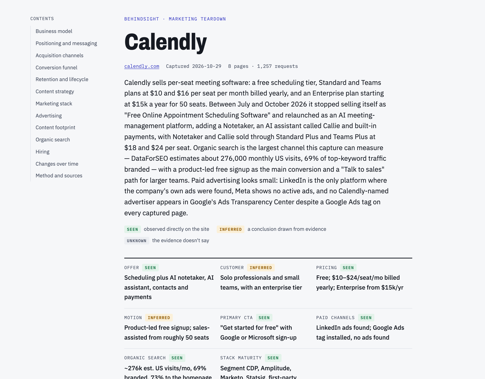

# Behindsight

See what's behind any company's website. Behindsight is an agent skill that reverse-engineers a company's marketing from its public website. Give it a domain. It returns an HTML report covering the business model, positioning, acquisition channels, conversion funnel, retention tools, content strategy, hiring, how the pitch and pricing changed over time, and the full marketing stack. Every claim is labeled **seen**, **inferred** or **unknown** and links to its evidence.



See the full [Calendly example report](examples/calendly.com/report.html). Download it and open it in a browser, since GitHub shows HTML files as source.

## What it collects

| Source | What you get |
|---|---|
| Key pages (home, pricing, product, signup, demo, customers, about) | Headlines, CTAs and where they lead, forms and their fields, JSON-LD offers, full page text |
| Network grab | Every pixel, tag and script the browser loads, before and after accepting cookies. Public account IDs (GTM containers, GA4 properties, Google Ads, Meta, LinkedIn, TikTok and more), tracking events like `sign_up` or `Lead`, and first-party or server-side tagging |
| [Wappalyzer](https://github.com/HTTPArchive/wappalyzer) | Technology detection from page code, using HTTP Archive's open-source fork. Detections confirmed by the network grab are marked as such. |
| Sitemap | Content sections and their size, comparison, integration and template pages, locales, and update dates by month |
| Content sample | The newest blog posts (from the feed, the blog index or the sitemap) and the posts that earn the most search traffic: publish dates, authors, length, headings, CTAs, lead forms and links to the product. The agent reads them and maps topics, formats, funnel stages and how posts turn readers into customers |
| Job boards | Open roles from the company's public job board (Greenhouse, Lever, Ashby, Workable, SmartRecruiters or Recruitee): counts by department and location, how recently roles were posted, and the marketing, sales and customer roles in full, including the tools their posts name |
| [Wayback Machine](https://web.archive.org) | About one archived copy per quarter of the homepage and pricing page over two years: how the headline, CTAs, prices and the tags in the page changed, with dates |
| Ad libraries | The company's own live ads from [Google's Ads Transparency Center](https://adstransparency.google.com), [Meta's Ad Library](https://www.facebook.com/ads/library) and [LinkedIn's Ad Library](https://www.linkedin.com/ad-library): counts, formats, dates, ad copy and sample images |
| [DataForSEO](https://dataforseo.com) (optional) | Estimated organic traffic and keywords, top keywords and pages, traffic by site section, and the sites competing for their non-branded keywords |

The agent reads all of this, then investigates whatever the first pass missed or got wrong: it can capture a page after clicking pricing toggles or tabs, inspect an unknown script, run extra keyword or competitor searches, or re-search an ad library under another advertiser name. Everything it gathers is saved alongside the rest of the evidence so it can be cited and checked. Then it writes `findings.json`. Two checks run before the report is built: a script matches every citation against the collected evidence, and an independent reviewer agent fact-checks each claim. The renderer then turns it into `report.html`.

## Install

Requires Node 20 or later and git. Setup checks your Node version and tells you how to install or update it if needed.

```sh
git clone https://github.com/crbdev/behindsight.git
cd behindsight/skills/behindsight
sh scripts/setup.sh
```

Setup installs Playwright with Chromium (about 600 MB of browser downloads) and fetches the latest Wappalyzer fork into `vendor/`. It test-runs Wappalyzer and falls back to a known-good version if the latest doesn't work. Rerun setup now and then to pick up new detections.

### Optional: search data

Add DataForSEO credentials to include organic search data. Copy the example file and fill it in:

```sh
cp .env.example .env
```

```
DATAFORSEO_LOGIN=you@example.com
DATAFORSEO_PASSWORD=your-api-password
```

Environment variables work too, and so does `~/.config/dataforseo/.env`, the file the DataForSEO MCP server reads. Each run makes four DataForSEO Labs calls (domain overview, organic keywords, top pages, search competitors), billed to your account. The collector prints the cost DataForSEO reports; a calendly.com run cost about $0.09. Use `--seo-location` and `--seo-language` for markets outside the US, and `--no-seo` to skip it.

### Use it as a skill

To use it as a Claude Code skill, copy or symlink `skills/behindsight` into `~/.claude/skills/` (or a project's `.claude/skills/`). Then ask: "Do a marketing teardown of example.com."

A full run with Claude Opus takes 25 to 40 minutes of agent work and uses roughly 6 to 12 million input tokens (almost all cached) and 70,000 to 100,000 output tokens: about $10 to $15 at API prices in tests on linear.app and zapier.com, plus about $0.10 of DataForSEO if enabled. Bigger sites with more to investigate cost more.

## Run the scripts directly

```sh
node scripts/collect.mjs example.com          # writes ./teardowns/example.com-<date>/
node scripts/collect.mjs example.com --seo-location 2826   # UK search data
# write findings.json (see references/report-schema.md)
node scripts/investigate.mjs page teardowns/example.com-<date> https://example.com/pricing --click "Monthly"   # follow-up evidence
node scripts/verify.mjs teardowns/example.com-<date>   # citation check
# independent review: references/review-prompt.md
node scripts/render.mjs teardowns/example.com-<date>
```

## Accuracy

Every report goes through two checks before it renders: a script matches each citation to the collected evidence, and a separate reviewer agent fact-checks every claim. On the Calendly example:

| Round | What changed before it | Items flagged by the reviewer |
|---|---|---|
| 1 | First draft | 25 of 47 |
| 2 | Detection fixes (tools served from the company's own domain, a Floodlight false positive) and writing rules learned from round 1 | 11 of 49 |
| 3 | A fresh run by an agent working alone from the published skill, with hiring, history and stricter ad matching added. This is the current example | 32 of 70 |

All flagged items were corrected before the example was published. Round 3 covers more ground than the first two and had no human edits, which is why the reviewer matters: most of its catches were installed ad tags described as active spend and search shares quoted without their basis. The lessons from each round go into the skill's writing rules.

## The example

`examples/calendly.com/` holds a real run: the report, the findings, the citation check, the reviewer's fact-check and the collected data summary. The raw captures it was built from (copies of Calendly's pages and its full network log) aren't included, so the citation check can't be rerun on this folder as published.

## Responsible use

Behindsight reads what any visitor's browser receives: public pages, public ad libraries and, with your own account, DataForSEO. It doesn't log in, submit forms, start trials or check out, and its investigation tool refuses clicks that could.

- The ad library step reads the libraries' public websites, not official APIs. Google, Meta and LinkedIn each have terms on automated access. You're responsible for using Behindsight in line with them, and with the terms of the sites you analyze. Skip ad libraries with `--no-ads`.
- Keep volumes low. One run loads about 7 pages plus a handful of ad library and sitemap requests. Don't point it at many sites in a loop.
- Reports describe what a company's public website and ads show. Inferences are labeled as such and can be wrong, so treat them as a starting point, not as fact about the company.

## Limits

- It reads public sources only: the website, the public ad libraries and, with credentials, DataForSEO. Social accounts and review sites are on the roadmap.
- History reads archived copies as plain HTML. Pages built by JavaScript can archive with little text, and tags loaded by a tag manager don't show in them.
- Job boards: only the six supported systems are read. Companies on Workday or a self-built careers page get no hiring data, and open roles show where a team is growing, not how big it is.
- Ad libraries show which ads run, not what they cost. LinkedIn shows impression ranges and run dates for some ads only. The ad library sites can change without notice, which may break that step.
- An ad account counts as the company's only when its name matches the brand and its ads link to the company's domain (or the company's site links to it). Short brand names collide often; when no account can be tied to the company, the report says so instead of guessing.
- An installed pixel shows a channel is set up. It doesn't show how much is spent.
- Tags and consent rules vary by country. Results reflect where you run it from.
- Some sites block headless browsers. The collector stops rather than guessing.

## Roadmap

- Google Tag Manager container parsing: list the tags and conversion events a container defines
- Review sites
- Funnel tracing with [REA](https://github.com/morluto/rea): follow a signup click to every request it fires

## License

MIT. The Wappalyzer fork is GPL-3.0. Setup clones it separately, and this repo doesn't include its code.
